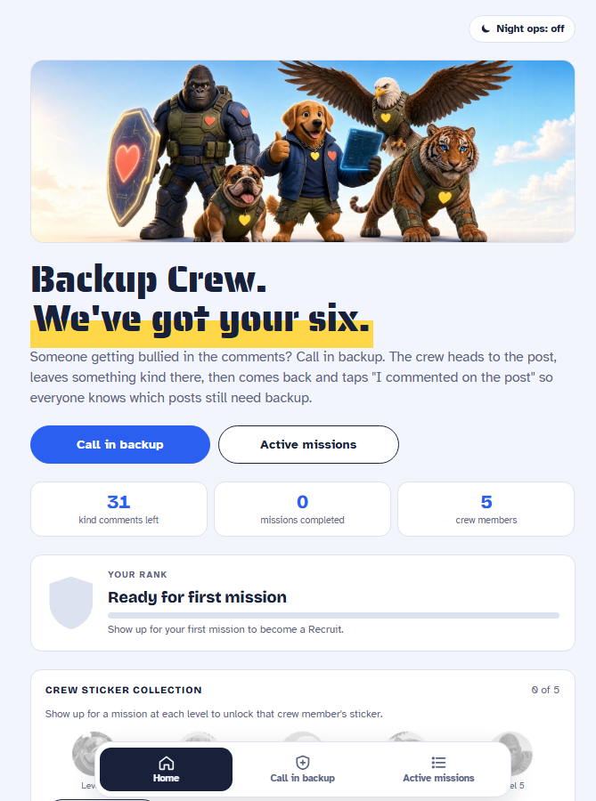

# Backup Crew

Backup Crew is an anti-bullying web app for students. When someone sees a post where a person is being bullied, they nominate it to the crew. Crew members then go to the original post and leave kind, supportive comments, so the person being targeted sees support instead of only cruelty.

**Live app:** https://backupcrew.org/

Built solo by Cheyenne Galler for the 2026 Congressional App Challenge. Code written with help from Claude; crew artwork made with Grok.

## Why I built this

Late one night, I came across a post making fun of someone I knew from school. One person made a joke, then another joined in, and soon the whole comment section was being cruel and laughing at someone who wasn't even there to defend themselves. I wanted to say something, so I did. I left a positive comment and passed it on to my friends to do the same. Soon there were a few positive comments, but it wasn't enough. They say that for every negative comment, it takes at least five positive comments to maintain the balance.

I couldn't stop thinking about it. Why did supporting someone online have to be so difficult? What if there were a place where people could come together to defend someone instead of joining in on the negativity?

That question became Backup Crew. I had never built anything like it, and I didn't have a team. But I decided that waiting until I knew everything about building an app would mean it would take too long, or I would never start in the first place. So I built the first version and entered it in the Congressional App Challenge.

## How it works
1. A student spots a post where someone is being bullied.
2. They nominate the post to Backup Crew.
3. Crew members leave kind and inspirational comments on the original post (without mentioning Backup Crew).
4. The person being bullied sees support instead of only cruelty.

## Features

- **Nominate a post:** Spot a post where someone is being bullied and send it to the crew.
- **Missions:** Crew members answer nominated posts with kind comments on the original post.
- **Ranks:** Every mission moves you up, starting with your first mission as a Recruit.
- **Crew sticker collection:** Unlock a crew member's sticker for each rank level you reach (5 in all).
- **Weekly backup challenge:** Back up 3 people in one week to earn a Backup Hero badge.
- **Crew member of the week:** A different crew member is featured each week.
- **Backup tips:** Advice from each crew member on how to leave comments that actually help.
- **Live stats:** See how many kind comments have been left, missions completed, and crew members.
- **Share my rank:** Share your rank once you've completed missions.
- **Privacy policy and child safety standards:** Linked right in the app.

## Built with

- **HTML, CSS, and JavaScript:** The whole app is one web page.
- **Firebase:** Sign-in and the database that stores nominations, missions, and comments.
- **Capacitor:** Turns the web app into Android and iOS apps.
- **Codemagic:** Builds the Android app for Google Play.
- **Static.app:** Hosts the live website.
- **Claude:** Helped write the code.
- **Grok:** Made the crew artwork.

## What's next

- **Google Play release:** Publishing Backup Crew as an Android app so students can use it on their phones.
- **Apple App Store:** Bringing it to iPhone after the Android release.
- **Student feedback:** Sharing it with students at my school and improving it based on what they say.

## Safety and privacy

- Crew members leave only kind comments. They never argue with or reply to the people doing the bullying.
- Crew members don't mention Backup Crew in their comments, so the support feels personal and the person being targeted isn't singled out.
- Crew members are encouraged to also report bullying comments to the platform.
- Backup Crew has a privacy policy and child safety standards, linked in the app.

## Contact

Questions or feedback: backupcrew4u@gmail.com

## Project structure
- `www/` – the web app (HTML, CSS, JavaScript)
- `android/` and `ios/` – native app wrappers built with Capacitor
- `codemagic.yaml` – build setup for the Google Play release

## How to run it
**Web:** Open the live link above, or download this repo and open `www/index.html` in a browser.

**Android:**
1. Install Node.js and Android Studio.
2. In this folder, run `npm install`
3. Run `npx cap sync android`
4. Run `npx cap open android`, then press Run in Android Studio.

## License
MIT
